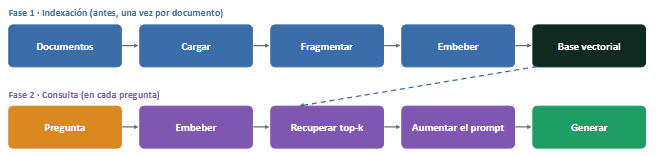
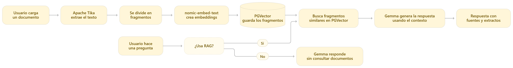
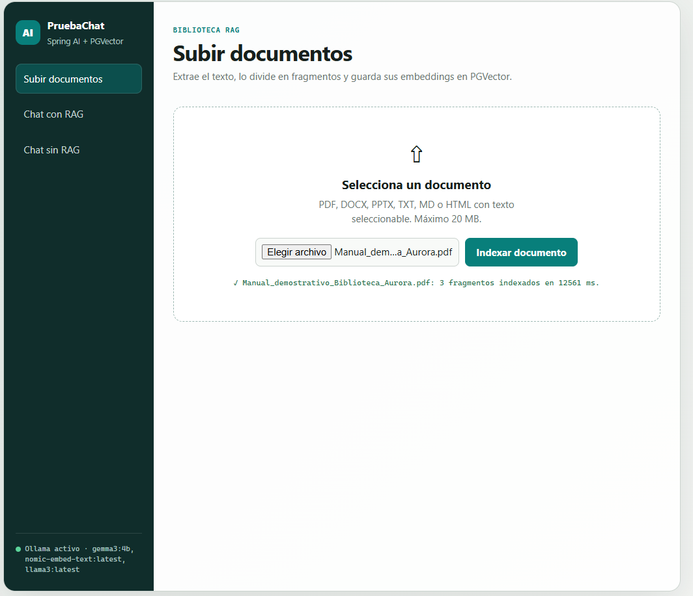
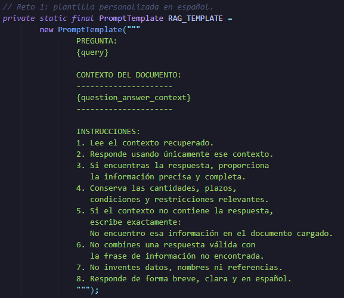
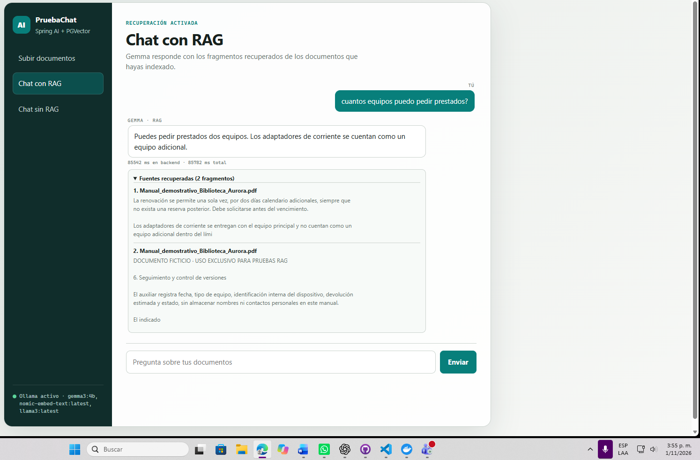

# Taller: Chat con documentos usando RAG (Spring AI + PGVector) 

 **Universidad El Bosque · Aplicaciones basadas en grandes modelos de lenguaje**  
 Documento de referencia: *Manual demostrativo de préstamo de equipos – Biblioteca Aurora* (6 páginas).

## 1. Integrantes y documento seleccionado

**Integrantes:**

- Daniel Felipe Agudelo Pérez
- José Daniel Villamil Duran
- Johan Sebastián Orjuela Heredia

**Documento RAG:** documento de la biblioteca Aurora que posee los horarios y reglas del préstamo de equipos, incluido en anexos/Manual_demostrativo_Biblioteca_Aurora.pdf. Tiene 6 páginas. Se eligió porque contiene normas concretas (horarios, límites, renovaciones, fallas, excepciones y reservas).

**Fuente:** documento ficticio elaborado con fines académicos para este taller.  Se encuentra en: `anexos/Manual_demostrativo_Biblioteca_Aurora.pdf`.

## 2. Arquitectura y flujo
Proceso de RAG

  

Cuando el usuario carga un documento, el frontend lo envía al backend mediante **POST /api/v1/documents.** El backend valida el archivo y Apache Tika extrae su contenido. Después, **TokenTextSplitter** divide el texto en fragmentos y agrega a cada uno el nombre del archivo como metadato. Luego **nomic-embed-text** transforma los fragmentos en vectores, que se almacenan junto con el texto y sus metadatos en PostgreSQL con PGVector.

Cuando el usuario hace una pregunta en el chat con RAG, esta se envía a **POST /api/v1/chat/rag.** Spring AI convierte la consulta en un vector y **QuestionAnswerAdvisor** busca en PGVector los fragmentos más similares, aplicando **topK** y **similarityThreshold.**
 La pregunta y los fragmentos recuperados se incorporan a una plantilla en español que ordena responder únicamente con el contenido del documento. Luego, gemma3:4b genera la respuesta. Finalmente, el backend devuelve tanto la respuesta como el nombre y un extracto de las fuentes recuperadas, que se muestran en la interfaz. En el chat sin RAG, la pregunta se envía directamente al modelo sin consultar PGVector.

 Diagrama de flujo

## 3. Ejecución

Con Docker o Docker Desktop en ejecución, abrir PowerShell en la carpeta raíz del proyecto y ejecutar el siguiente comando:

docker compose -f docker/docker-compose.yml up -d --build

Cuando los servicios ya estén disponibles, el front end se encuentra desde: http://localhost:4200. En el navegador. Desde está interfaz, se puede cargar el archivo utilizado (manual) o otros para realizar el procedimiento de embedding de los archivos PDF, para esté caso. El manual se encuentra disponible en la carpeta anexos/.

## 4. Paso 9. Prueba con un conjunto de preguntas

Resultados de las capturas y mediciones de una ejecución por pregunta.

| # | Pregunta | Respuesta esperada (página) | Sin RAG | Con RAG | ¿Correcta con RAG? |
|---|---|---|---|---|---|
| 1 | ¿Cuál es el horario de entrega y devolución de equipos de la Biblioteca Aurora? | L–V, 08:30–17:00; sin entregas/devoluciones fines de semana (p. 1). | Afirmó incorrectamente que no se ofrecen entregas/devoluciones. | Correcta: horario y fines de semana. | Sí |
| 2 | ¿Cuál es el número máximo de equipos que puede tener prestados un usuario al mismo tiempo? | Máximo 2 equipos por usuario (p. 3). | Inventó máximo de 20 equipos. | Correcta: máximo 2. | Sí |
| 3 | ¿Cuántas veces se puede renovar un préstamo ordinario y por cuántos días adicionales? | Una vez; 2 días calendario extra, sin reserva posterior y antes de vencimiento (p. 3). | Inventó 3 renovaciones de 7 días. | Correcta: una renovación por 2 días y condiciones. | Sí |
| 4 | ¿Dónde y en qué plazo debe reportarse una falla detectada en un equipo prestado? | En el punto de atención, máximo 24 horas desde detección (p. 4). | Inventó pasos adicionales, aunque mencionó 24 horas. | Correcta: lugar y plazo de 24 horas. | Sí |
| 5 | ¿Se puede retirar del edificio un equipo LAB-EXCLUSIVO si existe autorización de la coordinación académica? | No, ni siquiera con autorización académica (p. 5). | Sugirió que podría permitirse según autorización. | Incorrecta: dijo que no encontraba información. | No |
| 6 | ¿Cuánto tiempo permanece activa una reserva ordinaria y qué ocurre si no se reclama el equipo? | 12 horas hábiles desde aviso; luego se libera automáticamente (p. 5). | No indicó el plazo; respuesta genérica. | Correcta: 12 horas hábiles y liberación. | Sí |
| 7 | ¿Cómo se llama el director de la Biblioteca Aurora? | No figura en el documento. | Inventó el nombre «Elias Thorne». | Correcta: reconoció información ausente. | Sí |

**Resultado:** con RAG, 6/7 respuestas correctas; sin RAG, 0/7 totalmente correctas bajo el criterio de fidelidad al manual (una respuesta contenía un dato parcialmente acertado, acompañado por contenido no sustentado). La pregunta 7 permite comprobar abstención ante datos ausentes.

Indexación del documento.
La siguiente captura confirma que el documento fue procesado y dividido en tres fragmentos:

**NOTA:** LAS DEMAS EVIDENCIAS GRAFICAS SE ENCUENTRAN EN: anexos/Evidencias.pdf

## 5. Reto 1 — Prompt español y abstención

**SpringAiModelService.java** es el encargado de configurar una plantilla **PromptTemplate** con `{query}` y `{question_answer_context}` y la asigna a **QuestionAnswerAdvisor.promptTemplate(...)**. En el especificamos que: Exige usar solo el contexto, respetar restricciones y, cuando falte soporte, escribir: **«No encuentro esa información en el documento cargado.»** En la prueba sobre el director (pregunta 7), el sistema con RAG se abstuvo correctamente; sin RAG inventó un nombre.

### Plantilla personalizada en español

### Resultado del chat con RAG

La interfaz también muestra los fragmentos utilizados como fuentes de la respuesta:

## 6. Reto 2 — Tres configuraciones de recuperación

| Configuración | chunkSize | topK | Umbral | Fragmentos indexados | Correctas / 7 | Parciales | Promedio por pregunta (s) |
|---|---:|---:|---:|---:|---:|---:|---:|
| Referencia | 500 | 2 | 0.5 | 3 | 6/7 | 0 | 72.305 |
| A (pequeños) | 300 | 2 | 0.5 | 4 | 5/7 | 1 | 26.933 |
| C (grandes) | 800 | 3 | 0.6 | 2 | 2/7 | 0 | 26.061 |

**Nota:** las 7 preguntas se repitieron una sola vez en cada configuración y se midió el tiempo total mostrado por la interfaz. La configuración A varió únicamente `chunkSize` respecto de la referencia; la C varió los tres parámetros a la vez.

| Pregunta | Referencia: tiempo / evaluación | A: tiempo / evaluación | C: tiempo / evaluación |
|---|---|---|---|
| Horario | 84.138 s / Sí | 37.211 s / Sí | 56.981 s / Sí |
| Límite de equipos | 61.597 s / Sí | 23.218 s / Sí | 12.011 s / No |
| Renovación | 89.927 s / Sí | 24.607 s / Sí | 9.385 s / No |
| Reporte de fallas | 62.772 s / Sí | 24.732 s / Sí | 9.172 s / No |
| LAB-EXCLUSIVO | 68.124 s / No | 24.676 s / No | 40.388 s / No |
| Reserva ordinaria | 70.513 s / Sí | 30.439 s / Parcial | 15.106 s / No |
| Director (fuera del documento) | 69.061 s / Sí | 23.647 s / Sí | 39.384 s / Sí |

**Hallazgos:** la referencia obtuvo 6/7, A obtuvo 5/7 y C obtuvo 2/7. En A, la respuesta de reservas dio la duración correcta y la liberación automática, pero agregó contradictoriamente que esa información no estaba disponible (evaluación «Parcial»). La consulta LAB-EXCLUSIVO falló en las tres configuraciones. En C varias preguntas devolvieron 0 fragmentos recuperados aun estando el documento indexado; un umbral de 0.6 es una hipótesis plausible de filtrado, no una causa demostrada.

**NOTA:** LAS DEMAS EVIDENCIAS GRAFICAS SE ENCUENTRAN EN: anexos/Evidencias.pdf

## 7. Reto 3 — Evidencias de fuente

El backend accede a `QuestionAnswerAdvisor.RETRIEVED_DOCUMENTS` y construye información de fuentes con metadato `fuente` y extracto. En el frontend se muestra «Fuentes recuperadas (N fragmentos)» cuando existen. Esto representa **procedencia**, no una validación automática de veracidad. Se comprobó el comportamiento con capturas de preguntas con 2 fuentes y de preguntas sin fuentes.

## 8. Evidencias Graficas

El documento pdf complementario se encuentra `anexos/Evidencias.pdf` contiene capturas disponibles de las pruebas A y C.

## 9. Limitaciones y mejoras

- El modelo local en CPU presentó tiempos considerables y variables; los promedios proceden de solo 7 ejecuciones por configuración.
- LAB-EXCLUSIVO no se respondió correctamente pese a que la regla figura en el manual. Es necesario inspeccionar el texto completo de los fragmentos recuperados antes de culpar solo al umbral.
- Un documento cargado por segunda vez se agrega de nuevo; falta una operación de reemplazo automático por nombre/ID de documento.
- La configuración C cambió tres variables a la vez y no permite aislar su efecto individual.
- **Mejora propuesta:** construir un pequeño conjunto de evaluación automatizado que registre ID de fragmentos, puntuación de similitud, cobertura de evidencia y exactitud de respuesta; repetir mediciones bajo condiciones estables y probar los parámetros uno por uno.

## 10. Conclusiones

Este taller nos permitió entender mejor cómo funciona un sistema RAG y cómo puede mejorar las respuestas de una inteligencia artificial al utilizar información de un documento. En nuestras pruebas, el chat con RAG fue mucho más preciso que el chat sin RAG, que en varias ocasiones inventó información o dio respuestas incorrectas.
También comprobamos que **la configuración de los parámetros influye bastante en los resultados**. De las tres configuraciones que probamos, la que utilizaba `chunkSize=500`, `topK=2` y `similarityThreshold=0.5` fue la mejor, con 6 de 7 respuestas correctas.
Sin embargo, también encontramos algunas limitaciones. En ciertos casos, el sistema no recuperó información que sí estaba en el documento y, en otros, generó respuestas incompletas o contradictorias.
En general, el taller nos mostró que **RAG puede hacer que un modelo sea más confiable, pero no garantiza respuestas perfectas**. Por eso, es importante probar diferentes configuraciones, revisar los errores y no evaluar el sistema únicamente por su velocidad.

## 11. Referencias

- Universidad El Bosque. *Taller: Chat con documentos usando RAG (Spring AI + PGVector)*, pp. 10–12 (Paso 9, Retos 1–3, entregables).
- Spring AI Reference: https://docs.spring.io/spring-ai/reference/api/retrieval-augmented-generation.html
- pgvector: https://github.com/pgvector/pgvector
